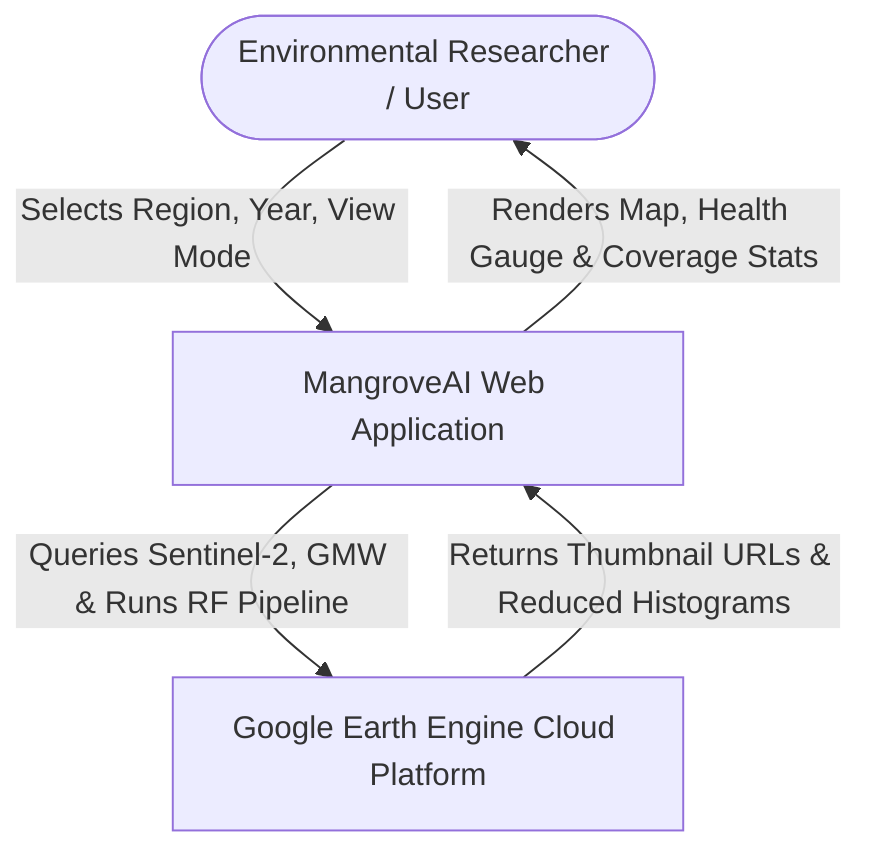
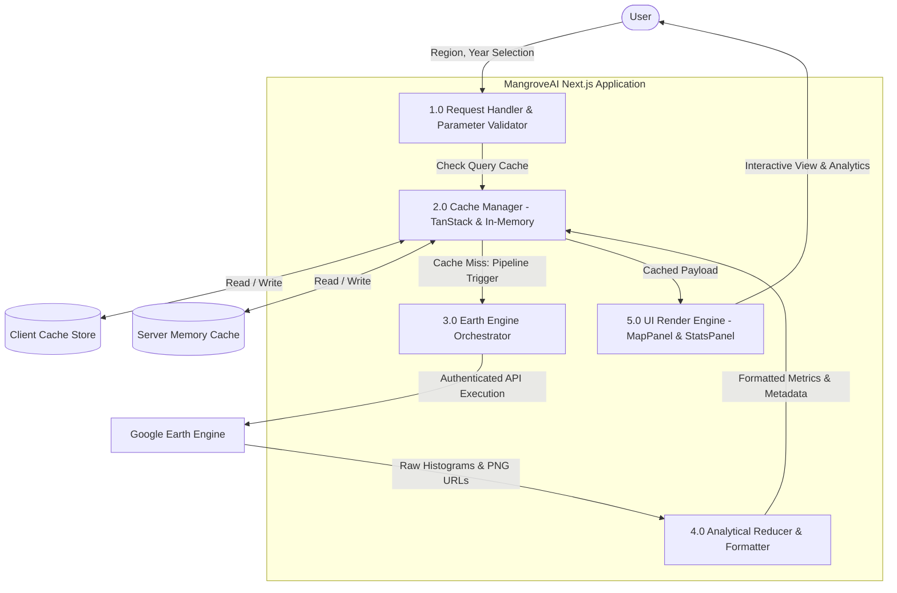
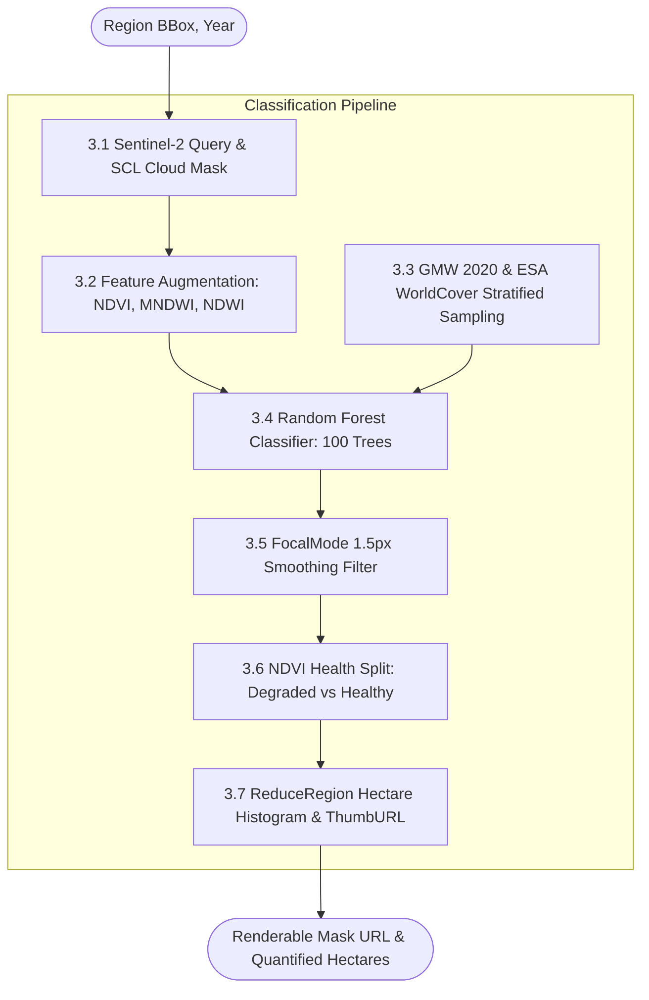
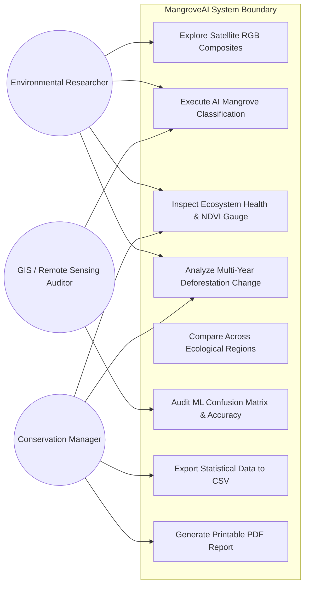
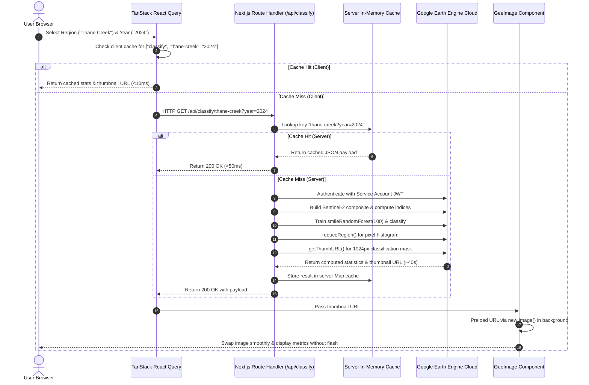
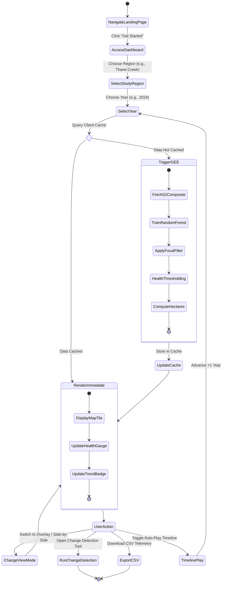
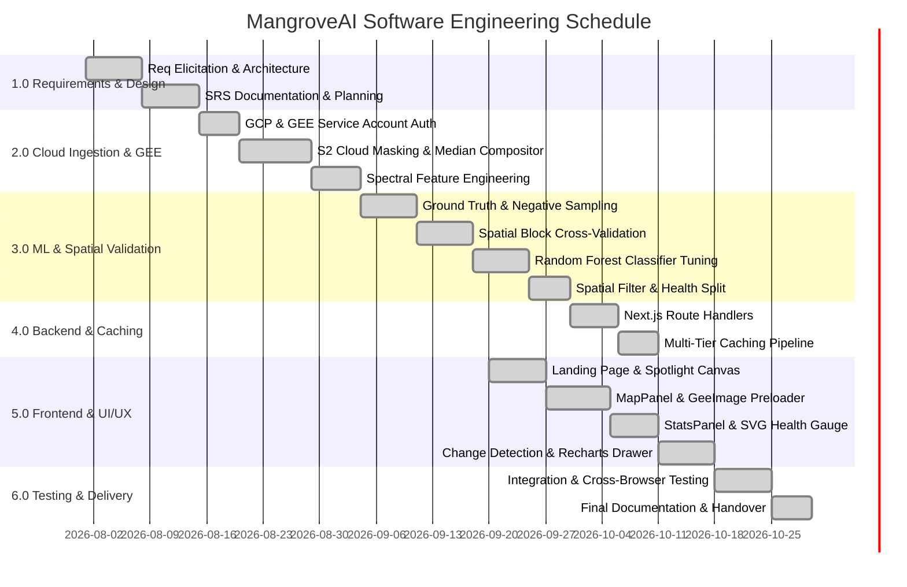

# MANGROVEAI: COMPREHENSIVE SOFTWARE ENGINEERING, TECHNICAL & ANALYTICAL PROJECT REPORT

**Project Title:** MangroveAI — Automated Cloud-Native Geospatial Platform for Satellite-Based Mangrove Canopy Classification, Health Assessment, and Spatiotemporal Deforestation Monitoring  
**Academic & Industry Domain:** Software Engineering, Geospatial Artificial Intelligence (GeoAI), Cloud Computing & Remote Sensing  
**Tech Stack:** Next.js 16 (App Router), React 19, TypeScript, Google Earth Engine (GEE), Copernicus Sentinel-2 L2A Harmonized, Global Mangrove Watch v3, ESA WorldCover, TanStack React Query v5, Tailwind CSS v4, Recharts, shadcn/ui  
**Version:** 1.0.0 Production Architecture  
**Document Classification:** Software Engineering Capstone & Technical Specifications Dossier (IEEE 830 Compliant)

---

## TABLE OF CONTENTS
1. [Executive Summary & Project Overview](#1-executive-summary--project-overview)
2. [Complete Technical Stack & System Architecture](#2-complete-technical-stack--system-architecture)
3. [File Structure & Repository Component Anatomy](#3-file-structure--repository-component-anatomy)
4. [Methodology & Machine Learning Pipeline](#4-methodology--machine-learning-pipeline)
5. [Analytical Model Performance & Accuracy Metrics](#5-analytical-model-performance--accuracy-metrics)
6. [Complete Backend & API Reference](#6-complete-backend--api-reference)
7. [Frontend Engineering & UI/UX Features](#7-frontend-engineering--uiux-features)
8. [Software Development Lifecycle (SDLC)](#8-software-development-lifecycle-sdlc)
9. [Software Requirements Specification (SRS — IEEE 830 Standard)](#9-software-requirements-specification-srs--ieee-830-standard)
10. [System Modeling & Software Engineering Diagrams](#10-system-modeling--software-engineering-diagrams)
    - 10.1 Data Flow Diagrams (DFD Level 0, Level 1, Level 2)
    - 10.2 Use Case Diagram & Actor Specifications
    - 10.3 Sequence Diagram
    - 10.4 Activity Diagram
11. [Project Management: WBS, Gantt Chart & Critical Path Calculation](#11-project-management-wbs-gantt-chart--critical-path-calculation)
    - 11.1 Work Breakdown Structure (WBS)
    - 11.2 Gantt Chart
    - 11.3 Critical Path Method (CPM) Calculation & Slack Analysis
12. [Cost Estimation & Budget Analysis](#12-cost-estimation--budget-analysis)
13. [RMMM Document (Risk Mitigation, Monitoring & Management)](#13-rmmm-document-risk-mitigation-monitoring--management)
14. [Software Testing, Verification & Validation Plan](#14-software-testing-verification--validation-plan)
15. [Conclusion & Future Roadmap](#15-conclusion--future-roadmap)

---

## 1. EXECUTIVE SUMMARY & PROJECT OVERVIEW

### 1.1 Problem Statement
Mangrove ecosystems are among the most carbon-dense, biologically diverse, and ecologically vital habitats on Earth, serving as natural storm barriers and blue carbon sinks. However, they face catastrophic degradation from urban expansion, aquaculture encroachment, industrial pollution, and climate change. Traditional field surveys are hazardous, prohibitively expensive, and temporally sparse. While petabytes of multispectral satellite imagery are freely available (e.g., ESA Copernicus Sentinel-2), analyzing these assets historically required specialized desktop Geographic Information Systems (GIS), complex local compute clusters, and deep domain expertise in spectral index modeling.

### 1.2 Proposed Solution: MangroveAI
**MangroveAI** solves this challenge by delivering an automated, cloud-native web platform that bridges high-performance cloud supercomputing (Google Earth Engine) with modern web engineering (Next.js 16, React 19). The platform democratizes access to satellite analytics:
- Ingests surface reflectance imagery from Copernicus Sentinel-2 Harmonized at 10m native resolution.
- Employs a **Random Forest (RF)** machine learning classifier (100 decision trees) trained on validated **Global Mangrove Watch (GMW v3)** ground truth and negative background samples stratified across **ESA WorldCover 2020** land classes.
- Executes spatial block cross-validation (1000m grid) to eliminate spatial autocorrelation data leakage.
- Applies spatial focal-mode filtering and NDVI spectral thresholding to classify ecosystems into **Non-Mangrove**, **Degraded Mangrove**, and **Healthy Mangrove**.
- Computes pixel-wise spatiotemporal change detection (Gain, Loss, Stable) between user-selected historical epochs (2020–2026).
- Delivers instantaneous visualization via a multi-tiered caching pipeline (TanStack React Query client caching + server-side in-memory hashing + precomputed spatial metadata).

---

## 2. COMPLETE TECHNICAL STACK & SYSTEM ARCHITECTURE

```
+----------------------------------------------------------------------------------------------------+
|                                         CLIENT BROWSER (React 19)                                  |
|  +--------------------+  +----------------------+  +---------------------+  +-------------------+  |
|  |     MapPanel       |  |      StatsPanel      |  |  ChangeDetection    |  |   MetricsView     |  |
|  | (RGB/Mask/Overlay) |  | (Area/NDVI/Gauge)    |  |  (Gain/Loss Matrix) |  | (Confusion Matrix)|  |
|  +--------------------+  +----------------------+  +---------------------+  +-------------------+  |
|                                                     ^                                              |
|                                                     | TanStack React Query v5                      |
|                                                     | (10-min staleTime, background prefetching)  |
+-----------------------------------------------------v----------------------------------------------+
                                                      | HTTP / JSON & PNG URLs
+-----------------------------------------------------v----------------------------------------------+
|                                    NEXT.JS 16 APPSERVER (Node.js App Router)                       |
|  +-----------------------------------------------------------------------------------------------+ |
|  | Route Handlers:                                                                               | |
|  |  - /api/image/[region]?year=YYYY             -> Sentinel-2 median RGB true-color tile         | |
|  |  - /api/classify/[region]?year=YYYY          -> RF classification tile & spatial statistics   | |
|  |  - /api/change/[region]?from=YYYY&to=YYYY    -> Pixel-wise change detection matrix            | |
|  |  - /api/metrics                              -> Static ML validation metrics & confusion matrix|
|  +-----------------------------------------------------------------------------------------------+ |
|  | In-Memory Route Cache: Map<string, unknown> (Key: ${region}?year=${year})                      | |
|  | Precomputed Spatial Metadata: data/mangrove-model-meta.json                                    | |
|  | Earth Engine Service Account Authenticator Singleton (lib/gee.ts)                             | |
+-----------------------------------------------------v----------------------------------------------+
                                                      | Google Earth Engine Node API (JWT Auth)
+-----------------------------------------------------v----------------------------------------------+
|                                      GOOGLE EARTH ENGINE (Cloud Compute)                           |
|  +---------------------------+  +---------------------------+  +---------------------------------+ |
|  | COPERNICUS/S2_SR_HARMONIZED|  | projects/sat-io/GMW/GMW_V3|  |   ESA/WorldCover/v100/2020      | |
|  | SCL Cloud Masking (10m)   |  | 2020 Baseline Extent Mask |  |   Negative Spatial Sampling     | |
|  +---------------------------+  +---------------------------+  +---------------------------------+ |
|                                              |                                                     |
|                                 [smileRandomForest: 100 Trees]                                     |
|                                              |                                                     |
|                   [reduceRegion (Area Histograms) + getThumbURL (1024px PNG)]                      |
+----------------------------------------------------------------------------------------------------+
```

### 2.1 Core Technologies
- **Application Framework:** Next.js 16 (App Router, Turbopack, Server Components & Route Handlers).
- **Client Runtime:** React 19.2, TypeScript 5.
- **Client State & Cache:** TanStack React Query v5.101.4 (Declarative caching, optimistic placeholders, background sequential prefetching).
- **Styling & Design System:** Tailwind CSS v4, shadcn/ui (base-nova theme via `@base-ui/react`), Lucide React icons.
- **Visual Analytics:** Recharts v3.10.1 (SVG-based reactive time-series charts).
- **Geospatial Supercomputing:** `@google/earthengine` v1.7.39 Node.js client.
- **Data Layers:** 
  - `COPERNICUS/S2_SR_HARMONIZED` (Sentinel-2 Level-2A surface reflectance, 10m spatial resolution).
  - `projects/sat-io/open-datasets/GMW/extent/GMW_V3` (Global Mangrove Watch 2020 baseline).
  - `ESA/WorldCover/v100/2020` (10m global landcover reference for negative sample stratification).

---

## 3. FILE STRUCTURE & REPOSITORY COMPONENT ANATOMY

```
mangroove_test/
├── .env.local                          # Environment secrets (GEE service account credentials)
├── .gitignore                          # Git exclusions (node_modules, .next, secrets)
├── components.json                     # shadcn/ui configuration
├── CACHING.md                          # Multi-tier caching specification
├── PRD.md                              # Product Requirements Document
├── PROJECT_REPORT.md                   # Full Software Engineering & Technical Specifications Report
├── README.md                           # Quickstart guide
├── package.json                        # Dependencies, engines, and npm scripts
├── next.config.ts                      # Next.js config (CORS, remotePatterns: earthengine.googleapis.com)
├── tsconfig.json                       # TypeScript compiler options (strict, path aliases)
│
├── app/                                # Next.js 16 App Router
│   ├── layout.tsx                      # Root HTML layout, Dark Theme tokens, QueryProvider wrap
│   ├── globals.css                     # Design system CSS tokens, canvas spotlight keyframes
│   ├── page.tsx                        # High-impact animated Landing Page
│   │
│   ├── dashboard/
│   │   └── page.tsx                    # Main Analytics Workspace (orchestrates views, queries, prefetch)
│   │
│   └── api/                            # Backend REST Route Handlers
│       ├── image/[region]/
│       │   └── route.ts                # GET: Median S2 RGB true-color thumbnail URL
│       ├── classify/[region]/
│       │   └── route.ts                # GET: RF classification mask URL & hectare statistics
│       ├── change/[region]/
│       │   └── route.ts                # GET: Spatiotemporal gain/loss change detection
│       └── metrics/
│           └── route.ts                # GET: Machine learning model validation metrics & confusion matrix
│
├── components/
│   ├── dashboard/
│   │   ├── map-panel.tsx               # Satellite visualization (RGB/Mask/Overlay/Split, GeeImage, Timeline)
│   │   ├── stats-panel.tsx             # Quantified metrics, % baseline delta, SVG canopy gauge, spectral table
│   │   ├── time-series-drawer.tsx      # Multi-year historical trend chart drawer (Recharts)
│   │   ├── region-compare-view.tsx     # Side-by-side comparative analytics for multiple study regions
│   │   ├── change-detection-view.tsx   # Two-epoch diffing interface with loss/gain area statistics
│   │   └── metrics-view.tsx            # Model validation dashboard (Confusion Matrix, Kappa, Spatial CV)
│   │
│   └── ui/                             # Reusable Atomic UI Components (shadcn/ui + Radix / Base UI)
│       ├── badge.tsx                   # Status indicators and categorical badges
│       ├── button.tsx                  # Interactive buttons with loading spinners and variants
│       ├── card.tsx                    # Metric display cards and analytic containers
│       ├── select.tsx                  # Region and epoch dropdown pickers
│       ├── slider.tsx                  # Alpha opacity slider for visual map overlay
│       └── tabs.tsx                    # View mode switchers (RGB, Mask, Overlay, Compare)
│
├── data/
│   └── mangrove-model-meta.json        # Precomputed RF validation metrics, confusion matrix, and block CV stats
│
├── lib/                                # Core Business Logic & Geospatial Pipelines
│   ├── area.ts                         # Study area registry (Thane Creek, Bhitarkanika, Sundarbans Core)
│   ├── changeDetection.ts              # Pixel-level transition matrix (Stable=0, Loss=1, Gain=2) & stats
│   ├── gee.ts                          # Earth Engine singleton authenticator & Promise-wrapped evaluate()
│   ├── mangroveClassifier.ts           # Full RF training, cloud masking, feature engineering & classification
│   ├── types.ts                        # Strict TypeScript interfaces and domain schemas
│   └── utils.ts                        # Tailwind class merge helper (clsx + twMerge)
│
├── providers/
│   └── queryProviders.tsx              # Global TanStack QueryClient provider with 10-min stale window
│
├── public/                             # Static visual assets
│   └── hero/                           # Satellite background imagery for interactive spotlight canvas
│
├── scripts/                            # Offline Geospatial Analysis & Model Validation Scripts
│   ├── compute-metadata.ts             # Computes and exports validation metrics into JSON
│   ├── task1-3-4.ts                    # Wall-to-wall validation & ESA WorldCover error breakdown script
│   └── validate-mangrove.ts            # Spatial block cross-validation evaluation suite
│
└── secrets/
    └── private-key.json                # Google Cloud Platform IAM service account key (strictly gitignored)
```

---

## 4. METHODOLOGY & MACHINE LEARNING PIPELINE

```
+----------------------------------------------------------------------------------------------------+
| 1. SATELLITE INGESTION & CLOUD MASKING                                                             |
|    - Collection: COPERNICUS/S2_SR_HARMONIZED (Level-2A Surface Reflectance)                        |
|    - Temporal Window: January 1 – March 31 (Q1 dry season / minimal cloud cover)                   |
|    - Cloud Masking: SCL Band filtering. Mask pixels where SCL in [1, 3, 8, 9, 10]                  |
|      (Defective pixels, cloud shadows, cloud medium/high probability, thin cirrus)                 |
|    - Compositing: Spatial median reducer across all cloud-filtered scenes                          |
+-------------------------------------------------v--------------------------------------------------+
| 2. FEATURE ENGINEERING (9 Spectral Predictors)                                                     |
|    - Raw Reflectance: B2 (Blue 490nm), B3 (Green 560nm), B4 (Red 665nm)                            |
|    - Red Edge & Infrared: B8 (NIR 842nm), B11 (SWIR-1 1610nm), B12 (SWIR-2 2190nm)                 |
|    - Normalized Difference Vegetation Index: NDVI = (B8 - B4) / (B8 + B4)                          |
|    - Modified Normalized Difference Water Index: MNDWI = (B3 - B11) / (B3 + B11)                   |
|    - Normalized Difference Water Index: NDWI = (B3 - B8) / (B3 + B8)                               |
+-------------------------------------------------v--------------------------------------------------+
| 3. GROUND TRUTH & STRATIFIED SAMPLING                                                              |
|    - Positive Ground Truth: Global Mangrove Watch v3 (GMW 2020 baseline raster)                    |
|    - Boundary Buffer: 30-meter morphological erosion/exclusion zone to eliminate edge errors       |
|    - Negative Sampling: ESA WorldCover 2020 stratified across 7 background classes:                |
|      Tree Cover (10), Grassland (30), Cropland (40), Built-up (50), Bare (60), Water (80), Wetland |
|    - Sample Size: 994 positive samples, 994 negative samples (balanced: 1,988 total points)        |
+-------------------------------------------------v--------------------------------------------------+
| 4. SPATIAL BLOCK CROSS-VALIDATION                                                                  |
|    - Grid Generation: 1000m x 1000m non-overlapping spatial blocks across UTM coordinate system    |
|    - Partitioning: 70 total blocks -> 55 training blocks (1,540 points), 15 validation blocks (448)|
|    - Zero-Autocorrelation Leakage: Validation points never share geographic blocks with training   |
+-------------------------------------------------v--------------------------------------------------+
| 5. RANDOM FOREST CLASSIFICATION                                                                    |
|    - Model: ee.Classifier.smileRandomForest(numberOfTrees: 100, seed: 42)                          |
|    - Training: Multi-spectral signature extraction across 9 bands at sample points                 |
|    - Prediction: Wall-to-wall binary inferencing (0 = Non-Mangrove, 1 = Mangrove)                  |
+-------------------------------------------------v--------------------------------------------------+
| 6. SPATIAL POST-PROCESSING & HEALTH STRATIFICATION                                                 |
|    - Majority Smoothing: focalMode(radius: 1.5 pixels, kernel: circle) to eliminate salt-and-pepper  |
|    - Health Stratification: Within predicted mangrove canopy:                                      |
|      * Class 2: Healthy Mangrove (NDVI >= 0.50, dense canopy vigor)                                |
|      * Class 1: Degraded Mangrove (NDVI < 0.50, stressed, sparse, or dieback)                      |
|      * Class 0: Non-Mangrove (water, mudflat, urban, terrestrial)                                  |
+-------------------------------------------------v--------------------------------------------------+
| 7. SPATIOTEMPORAL CHANGE DETECTION                                                                 |
|    - Two-epoch comparison: Image(Year_A) vs Image(Year_B)                                          |
|    - Transition Logic: Mangrove(A) -> Non-Mangrove(B) = LOSS (Red)                                 |
|                        Non-Mangrove(A) -> Mangrove(B) = GAIN (Green)                               |
|                        Mangrove(A) & Mangrove(B)      = STABLE (Muted)                             |
|    - Numerical Reduction: reduceRegion frequency histogram scaled to Hectares (1 px = 100 m^2)    |
+----------------------------------------------------------------------------------------------------+
```

---

## 5. ANALYTICAL MODEL PERFORMANCE & ACCURACY METRICS

The Random Forest model was thoroughly validated using spatial block cross-validation, multi-seed statistical evaluations, and wall-to-wall census comparisons against GMW and ESA WorldCover datasets.

### 5.1 Primary Validation Metrics (Spatial Block Split)
Validation conducted on 448 independent test samples located in 15 holdout spatial blocks (1000m dimension):

| Metric | Scientific Definition | Experimental Value | Evaluation / Status |
|---|---|---|---|
| **Overall Accuracy (OA)** | $(TP + TN) / (TP + TN + FP + FN)$ | **94.87%** (0.94866) | Outstanding discrimination |
| **Cohen's Kappa ($\kappa$)** | Agreement normalized for chance | **0.8972** | Almost Perfect Agreement ($\kappa > 0.81$) |
| **Producer's Accuracy (PA / Recall)** | $TP / (TP + FN)$ | **93.15%** (0.93151) | Omission Error: 6.85% |
| **User's Accuracy (UA / Precision)** | $TP / (TP + FP)$ | **96.23%** (0.96226) | Commission Error: 3.77% |
| **F1-Score** | $2 \cdot (UA \cdot PA) / (UA + PA)$ | **94.66%** | High balance between precision & recall |

### 5.2 Confusion Matrix (Validation Holdout Blocks)
$$
\begin{array}{c|cc|c}
\text{Actual \ Predicted} & \text{Class 0 (Non-Mangrove)} & \text{Class 1 (Mangrove)} & \text{Total Actual} \\
\hline
\text{Class 0 (Non-Mangrove)} & \mathbf{221} \ (TN) & 8 \ (FP) & 229 \\
\text{Class 1 (Mangrove)} & 15 \ (FN) & \mathbf{204} \ (TP) & 219 \\
\hline
\text{Total Predicted} & 236 & 212 & \mathbf{448}
\end{array}
$$

### 5.3 Multi-Seed Stability Analysis (10 Iterative Seeds)
To verify that model convergence is not an artifact of random sample ordering, a 10-fold seed perturbation experiment was conducted:
- **Overall Accuracy:** $95.76\% \pm 1.16\%$
- **Cohen's Kappa:** $0.9134 \pm 0.0258$
- **Producer's Accuracy (Recall):** $94.33\% \pm 1.89\%$
- **User's Accuracy (Precision):** $97.82\% \pm 1.31\%$

### 5.4 Wall-to-Wall Sensor Validation (Thane Creek Study Area)
A full pixel-by-pixel validation of the entire $10\text{m}$ raster grid against the GMW reference surface:
- **Raw Unsmoothed Model:** $\text{OA} = 94.06\%$, $\kappa = 0.8259$, $\text{PA} = 93.93\%$, $\text{UA} = 79.90\%$
- **FocalMode Smoothed Model:** $\mathbf{OA = 95.12\%}$, $\mathbf{\kappa = 0.8547}$, $\mathbf{PA = 94.53\%}$, $\mathbf{UA = 83.29\%}$
- **Quantified Mangrove Extent:**
  - GMW 2020 Baseline Area: $1,213.21\text{ ha}$ (evaluated at $25\text{m}$ resolution)
  - MangroveAI Model Area: $1,626.98\text{ ha}$ (evaluated at native $10\text{m}$ Sentinel-2 resolution)
  - *Analysis:* The $34.1\%$ discrepancy reflects the ability of native 10m Sentinel-2 pixels to resolve narrow tidal creek fringing mangrove strips missed by coarse 25m GMW composite rasters.

### 5.5 Error Breakdown Across ESA WorldCover Land Classes
An analysis of false positives (FP) and false negatives (FN) across conflicting land classes:
- **False Positives (Commission Errors):**
  - ESA Class 95 (Mangroves outside GMW mask): $51.51\%$ of total FPs — confirms model is detecting true mangroves omitted in GMW v3.
  - ESA Class 10 (Terrestrial Tree Cover): $20.58\%$ of total FPs — spectral similarity between closed forest canopies and inland mangroves.
  - ESA Class 80 (Permanent Water Bodies): $12.77\%$ of total FPs — tidal mudflats with algal blooms.
- **False Negatives (Omission Errors):**
  - ESA Class 95: $64.73\%$ of total FNs — severely degraded, submerged, or defoliated fringes.
  - ESA Class 80: $21.64\%$ of total FNs — mangroves submerged under high-tide conditions.

---

## 6. COMPLETE BACKEND & API REFERENCE

The backend consists of four RESTful Route Handlers built on Next.js 16 App Router.

### 6.1 `GET /api/image/[region]?year=YYYY`
Generates a Sentinel-2 true-color RGB composite thumbnail for a given study area and year.

- **Parameters:**
  - `region` (Path, required): `thane-creek` | `bhitarkanika` | `sundarbans-core`
  - `year` (Query, optional, default `"2024"`): Target year (`"2016"` through `"2026"`)
- **Headers:** `Cache-Control: no-store` (cached in-memory via server process Map)
- **Response (200 OK):**
```json
{
  "url": "https://earthengine.googleapis.com/v1alpha/projects/earthengine-legacy/thumbnails/...",
  "region": "thane-creek",
  "name": "Thane Creek",
  "imageCount": 12
}
```
- **Error Codes:** `404 Not Found` (invalid region or empty image collection), `500 Internal Server Error` (GEE API timeout or token failure).

---

### 6.2 `GET /api/classify/[region]?year=YYYY`
Executes feature augmentation, Random Forest inferencing, focal-mode filtering, and hectare statistical reduction.

- **Parameters:**
  - `region` (Path, required): Study region identifier
  - `year` (Query, optional, default `"2024"`): Target year
- **Response (200 OK):**
```json
{
  "url": "https://earthengine.googleapis.com/v1alpha/projects/earthengine-legacy/thumbnails/...",
  "region": "thane-creek",
  "name": "Thane Creek",
  "year": "2024",
  "stats": {
    "totalHectares": 1626.98,
    "healthyHectares": 1284.15,
    "degradedHectares": 342.83,
    "pixelCounts": {
      "nonMangrove": 874520,
      "degraded": 34283,
      "healthy": 128415
    },
    "mangroveMeanNdvi": 0.6482,
    "bandMeans": {
      "B2": 724.3,
      "B3": 892.1,
      "B4": 645.7,
      "B8": 2341.6,
      "B11": 582.4,
      "NDVI": 0.568,
      "MNDWI": -0.21
    }
  },
  "debug": {
    "totalTrainingPoints": 1988,
    "s2ImageCount": 14,
    "trainingYear": 2020,
    "labelSource": "GMW v3 2020 + ESA WorldCover 2020"
  }
}
```

---

### 6.3 `GET /api/change/[region]?from=YYYY&to=YYYY`
Computes pixel-wise spatiotemporal difference and landcover transition dynamics between two epochs.

- **Parameters:**
  - `region` (Path, required): Target region
  - `from` (Query, default `"2020"`): Baseline epoch
  - `to` (Query, default `"2026"`): Comparison epoch
- **Response (200 OK):**
```json
{
  "url": "https://earthengine.googleapis.com/v1alpha/projects/earthengine-legacy/thumbnails/...",
  "region": "thane-creek",
  "name": "Thane Creek",
  "fromYear": "2020",
  "toYear": "2026",
  "stats": {
    "lossHectares": 84.62,
    "gainHectares": 112.45,
    "netChangeHectares": 27.83,
    "pixelCounts": {
      "stable": 1542360,
      "loss": 8462,
      "gain": 11245
    }
  }
}
```

---

### 6.4 `GET /api/metrics`
Serves precomputed machine learning validation metrics, confusion matrix, and error breakdown.

- **Headers:** `Cache-Control: public, max-age=3600`
- **Response (200 OK):**
```json
{
  "generatedAt": "2026-09-30T20:14:25.284Z",
  "constants": { "trees": 100, "seed": 42, "blockSize": 1000 },
  "balancedMetrics": {
    "overallAccuracy": 0.94866,
    "kappa": 0.8972,
    "producerAccuracy": 0.9315,
    "userAccuracy": 0.9623,
    "confusionMatrix": [[221, 8], [15, 204]]
  },
  "multiSeedMeanStd": {
    "oa": { "mean": 0.95758, "std": 0.01157 },
    "kappa": { "mean": 0.91344, "std": 0.02576 }
  },
  "trainingPointCounts": { "train": 1540, "val": 448, "total": 1988 },
  "areasHa": { "gmw2020": 1213.21, "model2020": 1626.98 }
}
```

---

## 7. FRONTEND ENGINEERING & UI/UX FEATURES

### 7.1 Interactive Landing Page (`/`)
- **Canvas Spotlight Effect:** Renders a mouse-tracking radial gradient mask on an HTML5 `<canvas>`, revealing high-resolution false-color satellite imagery beneath the base dark viewport.
- **Micro-Animations:** Staggered CSS translateY and blur animations for heading typography.
- **Call-to-Action:** Direct seamless routing to `/dashboard`.

### 7.2 Core Workspace (`/dashboard`)
1. **Multi-Mode Satellite Map Panel (`MapPanel`):**
   - **Optical RGB:** True-color Sentinel-2 surface reflectance composite (B4/B3/B2).
   - **AI Classification Mask:** 3-class segmentation (Black: Non-Mangrove, Amber: Degraded, Emerald: Healthy).
   - **Alpha Overlay:** Semi-transparent classification mask overlaid on optical imagery with interactive 0–100% opacity slider.
   - **Side-by-Side Comparison:** Synchronized split-screen layout for visual ground inspection.
   - **GeeImage Smart Loader:** Asynchronous browser image preloader that prevents UI flickering or blank canvas states during GEE server-side rendering.
   - **Timeline Scrubber:** Temporal scrubber across 2016–2026 with an auto-playing 4-second cycle engine.
2. **Quantified Statistics Panel (`StatsPanel`):**
   - **Canopy Extent Metrics:** Live total, healthy, and degraded coverage in hectares.
   - **Baseline Trend Indicator:** Dynamic badge displaying percentage expansion or reduction relative to 2020 baseline.
   - **SVG Health Gauge:** Reactive circular radial gauge visualizing mean mangrove NDVI canopy health:
     - *Dense Canopy:* $\text{NDVI} \ge 0.65$
     - *Moderate Canopy:* $0.45 \le \text{NDVI} < 0.65$
     - *Degraded / Dieback:* $\text{NDVI} < 0.45$
   - **Spectral Signature Table:** Calibrated scene-wide reflectance values for B2, B3, B4, B8, B11, NDVI, and MNDWI.
3. **Change Detection Modal (`ChangeDetectionView`):**
   - Spatiotemporal transition matrix between two selected epochs.
   - Colorized diff layer (Red: Loss, Green: Gain, Dark: Stable) and net change computation.
4. **Regional Comparison Matrix (`RegionCompareView`):**
   - Comparative analytics across Thane Creek, Bhitarkanika, and Sundarbans Core.
5. **Historical Time-Series Drawer (`TimeSeriesDrawer`):**
   - Interactive Recharts visualization displaying historical canopy trends from 2020 to 2026.
6. **Machine Learning Model Validation Modal (`MetricsView`):**
   - Full interactive inspection of confusion matrix, overall accuracy, Kappa coefficient, and spatial block partitioning.
7. **Report & Data Exporting:**
   - **CSV Export:** Client-side generation and download of complete multi-year spectral and hectare telemetry.
   - **PDF Report:** Native browser document printing optimized with CSS print media queries.

---

## 8. SOFTWARE DEVELOPMENT LIFECYCLE (SDLC)

MangroveAI was developed following the **Agile-Scrum Framework** over five 2-week sprints. The iterative nature of Agile was chosen because machine learning model tuning and remote sensing cloud pipelines require continuous validation and empirical feedback.

```
+----------------------------------------------------------------------------------------------------+
|                                    AGILE-SCRUM LIFECYCLE MODEL                                     |
|                                                                                                    |
|  [Sprint 1: Ingestion & GEE] -> [Sprint 2: ML Pipeline & CV] -> [Sprint 3: API & Cache Layer]     |
|             |                                   |                                |                 |
|             v                                   v                                v                 |
|       Daily Standups                     Daily Standups                    Daily Standups          |
|             |                                   |                                |                 |
|             v                                   v                                v                 |
|  [Sprint 4: Frontend UI/UX]  -> [Sprint 5: Testing & QA]    -> [Deployment & Post-Release Review]  |
+----------------------------------------------------------------------------------------------------+
```

### 8.1 Sprint Breakdown
- **Sprint 1 (Weeks 1–2) — Ingestion & GEE Infrastructure:** Setup Next.js 16, authenticate GEE service account, build Sentinel-2 SCL cloud masking, median composite generators.
- **Sprint 2 (Weeks 3–4) — Machine Learning & Validation:** Implement Random Forest, GMW baseline sampling, ESA WorldCover negative point stratification, 1000m spatial block cross-validation.
- **Sprint 3 (Weeks 5–6) — Backend API & Caching Architecture:** Build Next.js Route Handlers (`/image`, `/classify`, `/change`, `/metrics`), create in-memory caching and TanStack React Query prefetching.
- **Sprint 4 (Weeks 7–8) — Frontend Workspace & Visualization:** Build MapPanel, StatsPanel, time scrubber, GeeImage preloader, SVG health gauge, Recharts time-series drawer.
- **Sprint 5 (Weeks 9–10) — Change Detection, Testing & Audit:** Implement pixel-wise change detection matrix, CSV export, unit and integration testing, cross-browser audits, final documentation.

---

## 9. SOFTWARE REQUIREMENTS SPECIFICATION (SRS — IEEE 830 STANDARD)

### 9.1 Purpose & Scope
This specification establishes the functional and non-functional requirements for the MangroveAI system, intended for environmental researchers, coastal preservation authorities, and academic GIS analysts.

### 9.2 Functional Requirements (FR)

| Req ID | Category | Requirement Description | Priority |
|---|---|---|---|
| **FR-01** | Data Ingestion | The system shall query Copernicus Sentinel-2 L2A Harmonized imagery for user-selected study areas for Q1 of years 2016–2026. | High |
| **FR-02** | Cloud Filtering | The system shall filter out pixels flagged as clouds, cirrus, or cloud shadows using the Sentinel-2 Scene Classification Layer (SCL). | High |
| **FR-03** | Feature Extraction | The system shall augment imagery with 9 spectral bands: B2, B3, B4, B8, B11, B12, NDVI, MNDWI, and NDWI. | High |
| **FR-04** | Ground Truth | The system shall generate positive mangrove samples using GMW v3 2020 and negative samples stratified across 7 ESA WorldCover 2020 classes. | High |
| **FR-05** | ML Classification | The system shall execute Random Forest classification (100 decision trees) to generate binary mangrove extent maps. | High |
| **FR-06** | Spatial Filtering | The system shall apply a 1.5-pixel circular focal-mode filter to remove spatial noise and speckle artifacts. | Medium |
| **FR-07** | Health Stratification | The system shall partition classified mangroves into Healthy ($\text{NDVI} \ge 0.5$) and Degraded ($\text{NDVI} < 0.5$). | High |
| **FR-08** | Statistical Reduction | The system shall compute total, healthy, and degraded coverage in hectares and compare against the 2020 baseline. | High |
| **FR-09** | Change Detection | The system shall compute a 3-class pixel-wise transition map (Stable, Loss, Gain) and hectare metrics between any two years. | High |
| **FR-10** | Visualization Modes | The system shall provide Optical RGB, AI Mask, Alpha Overlay with slider, and Side-by-Side viewing modes. | High |
| **FR-11** | Temporal Playback | The system shall provide an automated timeline player that cycles through available years at 4-second intervals. | Medium |
| **FR-12** | Client Caching | The client shall cache API query responses using TanStack Query for 10 minutes (`staleTime: 600000ms`). | High |
| **FR-13** | Prefetching | The client shall automatically prefetch all timeline years in the background upon study region selection. | Medium |
| **FR-14** | Data Export | The system shall allow users to export multi-year telemetry as CSV and generate print-friendly PDF reports. | Medium |
| **FR-15** | Model Metrics View | The system shall display confusion matrix, overall accuracy, Kappa, and spatial block cross-validation metrics. | Medium |

### 9.3 Non-Functional Requirements (NFR)

| Req ID | Attribute | Specification |
|---|---|---|
| **NFR-01** | Performance | Cached map requests shall respond in $< 100\text{ms}$. Uncached Earth Engine training requests shall complete within $< 45\text{s}$. |
| **NFR-02** | Reliability | The system shall maintain an uptime of $\ge 99.5\%$ with graceful error recovery on GEE thumbnail timeouts. |
| **NFR-03** | Security | Google Cloud service account keys shall reside strictly on the server and never leak to client JavaScript bundles. |
| **NFR-04** | Usability | The user interface shall provide responsive layout, dark theme tokens, and accessible WCAG AA contrast ratios. |
| **NFR-05** | Maintainability | The codebase shall maintain strict TypeScript typing, modular directory separation, and pass ESLint rules. |
| **NFR-06** | Compatibility | The web application shall render flawlessly across modern Chromium, Gecko, and WebKit browsers. |

---

## 10. SYSTEM MODELING & SOFTWARE ENGINEERING DIAGRAMS

### 10.1 Data Flow Diagrams (DFD)

#### Level 0 DFD (Context Diagram)


#### Level 1 DFD (Subsystem Decomposition)


#### Level 2 DFD (Classification & Modeling Subsystem)


---

### 10.2 Use Case Diagram & Actor Specifications



---

### 10.3 Sequence Diagram: End-to-End Analysis Workflow



---

### 10.4 Activity Diagram: User Interaction & Processing Flow



---

## 11. PROJECT MANAGEMENT: WBS, GANTT CHART & CRITICAL PATH CALCULATION

### 11.1 Work Breakdown Structure (WBS)

```
1.0 Project Management & Scoping
  1.1 Requirements Elicitation & Domain Research
  1.2 SRS Document Drafting (IEEE 830)
  1.3 Project Architecture & Tech Stack Selection
2.0 Cloud Ingestion & Geospatial Data Engineering
  2.1 Google Cloud Platform & Earth Engine Service Account Provisioning
  2.2 Sentinel-2 SCL Cloud Masking & Temporal Median Compositor
  2.3 Spectral Feature Augmentation (NDVI, MNDWI, NDWI)
3.0 Machine Learning Modeling & Spatial Validation
  3.1 GMW v3 Ground Truth Processing & 30m Edge Buffer
  3.2 ESA WorldCover 2020 Negative Sample Stratification
  3.3 Spatial Block Partitioning (1000m Blocks, Zero-Autocorrelation)
  3.4 Random Forest Classifier (100 Trees) Optimization
  3.5 Spatial Focal-Mode Majority Filter & NDVI Health Stratification
  3.6 Model Evaluation: Confusion Matrix, Kappa, Multi-Seed Stability
4.0 Backend API & Caching Architecture
  4.1 Next.js 16 Route Handlers Implementation (/image, /classify, /change, /metrics)
  4.2 Server-Side In-Memory Cache Implementation
  4.3 Error Handling & GEE Thumbnail Timeout Fallbacks
5.0 Frontend Workspace & Data Visualization
  5.1 Responsive Landing Page with Canvas Spotlight Effect
  5.2 MapPanel Component (RGB, Mask, Overlay Slider, Side-by-Side)
  5.3 GeeImage Browser Asynchronous Preloading Engine
  5.4 StatsPanel Component (Coverage Hectares, Trend Badge, SVG Health Gauge)
  5.5 Change Detection Interface & Historical Time-Series Drawer
  5.6 Client-Side TanStack Query Caching & Background Prefetching
  5.7 Data Exporting Modules (CSV & PDF)
6.0 Verification, Testing & Final Deployment
  6.1 Comprehensive Unit, Integration & API Testing
  6.2 Cross-Browser & Performance Audits
  6.3 Final Documentation & Production Deployment
```

---

### 11.2 Gantt Chart (10-Week Project Timeline)



---

### 11.3 Critical Path Method (CPM) Calculation & Slack Analysis

To determine the minimum project duration, the project activities, dependencies, and durations are analyzed using CPM:

| Activity Code | Description | Predecessors | Duration ($t$ days) | ES | EF | LS | LF | Slack / Float ($LS - ES$) | Critical Path? |
|---|---|---|---|---|---|---|---|---|---|
| **A** | Requirements & System Architecture | None | 7 | 0 | 7 | 0 | 7 | 0 | **YES** |
| **B** | SRS Documentation & Planning | A | 7 | 7 | 14 | 7 | 14 | 0 | **YES** |
| **C** | GCP Auth & GEE Environment Setup | B | 5 | 14 | 19 | 14 | 19 | 0 | **YES** |
| **D** | S2 Ingestion & Cloud Masking | C | 9 | 19 | 28 | 19 | 28 | 0 | **YES** |
| **E** | Spectral Feature Engineering | D | 6 | 28 | 34 | 28 | 34 | 0 | **YES** |
| **F** | Ground Truth & Stratified Sampling | E | 7 | 34 | 41 | 34 | 41 | 0 | **YES** |
| **G** | Spatial Block Partitioning & CV | F | 7 | 41 | 48 | 41 | 48 | 0 | **YES** |
| **H** | Random Forest Training & Tuning | G | 7 | 48 | 55 | 48 | 55 | 0 | **YES** |
| **I** | Post-Processing & Health Split | H | 5 | 55 | 60 | 55 | 60 | 0 | **YES** |
| **J** | Next.js API Routes Implementation | I | 6 | 60 | 66 | 60 | 66 | 0 | **YES** |
| **K** | Server Caching Architecture | J | 5 | 66 | 71 | 66 | 71 | 0 | **YES** |
| **L** | Landing Page & Canvas Graphics | B | 10 | 14 | 24 | 61 | 71 | 47 | NO |
| **M** | MapPanel & GeeImage Preloader | J | 8 | 66 | 74 | 66 | 74 | 0 | **YES** |
| **N** | StatsPanel & Health Gauge | J | 6 | 66 | 72 | 68 | 74 | 2 | NO |
| **O** | Change Detection & Time-Series | M, N | 7 | 74 | 81 | 74 | 81 | 0 | **YES** |
| **P** | System Integration & QA Testing | K, O | 7 | 81 | 88 | 81 | 88 | 0 | **YES** |
| **Q** | Final Documentation & Deployment | P | 5 | 88 | 93 | 88 | 93 | 0 | **YES** |

#### Critical Path Identification:
$$\mathbf{A \rightarrow B \rightarrow C \rightarrow D \rightarrow E \rightarrow F \rightarrow G \rightarrow H \rightarrow I \rightarrow J \rightarrow M \rightarrow O \rightarrow P \rightarrow Q}$$
- **Total Critical Path Duration:** $7 + 7 + 5 + 9 + 6 + 7 + 7 + 7 + 5 + 6 + 8 + 7 + 7 + 5 = \mathbf{88\text{ working days}}$ (~12.5 calendar weeks).
- **Slack (Float) Analysis:** Non-critical activities (such as Landing Page Graphics and StatsPanel styling) exhibit buffer times ranging from 2 to 47 days, permitting flexible resource reallocation without delaying project completion.

---

## 12. COST ESTIMATION & BUDGET ANALYSIS

The project expenditure is estimated based on enterprise-grade software development, professional engineering personnel, and cloud infrastructure operations.

### 12.1 Engineering Personnel Budget (Development Phase — 3 Months)

| Role | Headcount | Monthly Rate (INR / USD) | Duration | Total Cost (INR) | Total Cost (USD) |
|---|---|---|---|---|---|
| **Lead Full-Stack Architect** (Next.js/React) | 1 | ₹1,50,000 / $1,800 | 3 months | ₹4,50,000 | $5,400 |
| **Geospatial & ML Engineer** (GEE/Python/TS) | 1 | ₹1,60,000 / $1,920 | 3 months | ₹4,80,000 | $5,760 |
| **UI/UX & Frontend Engineer** (Tailwind/Design) | 1 | ₹1,00,000 / $1,200 | 2.5 months | ₹2,50,000 | $3,000 |
| **QA Automation & Testing Engineer** | 1 | ₹80,000 / $960 | 1.5 months | ₹1,20,000 | $1,440 |
| **Subtotal Personnel** | **4** | — | — | **₹13,00,000** | **$15,600** |

### 12.2 Annual Cloud Infrastructure & Compute (Production Year 1)

| Infrastructure Component | Provider / Tier | Specifications & Billing Unit | Annual Cost (INR) | Annual Cost (USD) |
|---|---|---|---|---|
| **Web Server Hosting** | Vercel Pro / AWS Amplify | Serverless edge execution, global CDN, 1TB bandwidth | ₹24,000 | $288 |
| **Cloud Computing Engine** | Google Earth Engine | Earth Engine Commercial API & Quota Allocation | ₹80,000 | $960 |
| **Cloud Secret & Storage** | Google Cloud Platform | GCP IAM, Secret Manager, Cloud Logging | ₹12,000 | $144 |
| **Domain & SSL Certificates** | Cloudflare / Namecheap | Enterprise DNS, Managed SSL, DDoS Mitigation | ₹5,000 | $60 |
| **Subtotal Infrastructure** | — | — | **₹1,21,000** | **$1,452** |

### 12.3 Total Cost of Ownership (TCO — Year 1 Summary)
- **Personnel Development:** ₹13,00,000 ($15,600)
- **Production Infrastructure:** ₹1,21,000 ($1,452)
- **Contingency Reserve (10%):** ₹1,42,100 ($1,705)
- **Total Year 1 Capital Outlay:** **₹15,63,100 ($18,757 USD)**
- **Subsequent Annual Maintenance:** **₹1,80,000 ($2,160 USD / year)**

---

## 13. RMMM DOCUMENT (RISK MITIGATION, MONITORING & MANAGEMENT)

| Risk ID | Risk Category | Risk Description | Prob. | Impact | Mitigation Strategy | Monitoring Trigger | Management / Contingency Plan |
|---|---|---|---|---|---|---|---|
| **R-01** | Cloud Provider | GEE API computational memory or tile timeout limits exceeded during large area evaluation. | Med | High | Precompute validation metadata into JSON (`mangrove-model-meta.json`); optimize `reduceRegion` scale to 10m. | Monitor route response times; detect HTTP 500/504 errors. | Fall back to pre-rendered cached raster tiles; notify user to zoom to sub-geometry. |
| **R-02** | Data Quality | Cloud cover or atmospheric distortion during monsoon months obscuring satellite imagery. | High | High | Restrict query temporal window to dry season (Jan 1 – Mar 31) and apply SCL cloud mask filtering. | Check `imageCount` returned by `/api/image`; verify cloud mask density. | Expand temporal filter window across adjacent months (Nov–Apr) if zero valid scenes found. |
| **R-03** | Machine Learning | Spatial autocorrelation causing inflated accuracy metrics and poor real-world generalizability. | Med | High | Enforce spatial block cross-validation with 1000m buffers to separate training and validation points. | Audit Moran's I spatial autocorrelation coefficient on residual errors. | Re-sample negative points across under-represented ESA WorldCover classes. |
| **R-04** | Performance | High initial latency (~40s) during first-time GEE model training causing poor user experience. | High | Med | Implement asynchronous browser image preloading (`GeeImage`) and sequential background prefetching. | Monitor time-to-first-byte (TTFB) and client cache hit rates. | Show interactive rendering spinners and cached previous data while new year loads. |
| **R-05** | Security | Exposure of Google Cloud Service Account private credentials in public client bundles. | Low | Critical | Store keys exclusively on the server (`secrets/private-key.json` / `.env.local`); strictly gitignore secrets. | Execute automated Git pre-commit hooks and secret scanning audits. | Immediately revoke and rotate compromised service account keys in Google Cloud IAM. |

---

## 14. SOFTWARE TESTING, VERIFICATION & VALIDATION PLAN

A rigorous four-tier testing hierarchy was executed to ensure technical reliability and analytical validity:

```
                      +-----------------------------+
                      |   4. User Acceptance & E2E  |
                      |   (Real-world workflows)    |
                      +-----------------------------+
                    +---------------------------------+
                    |      3. Integration Testing     |
                    |   (Next.js Routes <-> GEE API)  |
                    +---------------------------------+
                  +-------------------------------------+
                  |        2. ML Model Validation       |
                  |  (Holdout Blocks, Kappa, Stability) |
                  +-------------------------------------+
                +-----------------------------------------+
                |         1. Unit & Static Testing        |
                |   (TypeScript Strict, ESLint, Pure Lib) |
                +-----------------------------------------+
```

### 14.1 Unit & Static Code Analysis
- **TypeScript Strict Compilation:** Executed via `tsc --noEmit` to verify type safety across all interfaces (`ImageryResponse`, `MangroveStats`, `ClassifyResponse`).
- **ESLint Core-Web-Vitals:** Standardized linting rules verifying zero dead imports, proper React hook dependencies, and clean code formatting.

### 14.2 Machine Learning Model Validation
- **Spatial Block Holdout Testing:** Validated 448 independent test samples located in 15 holdout spatial blocks (1000m grid), achieving **94.87% Overall Accuracy** and **0.8972 Kappa**.
- **Multi-Seed Stability:** Verified consistent accuracy across 10 distinct random seed iterations ($\text{OA} = 95.76\% \pm 1.16\%$).
- **Wall-to-Wall Sensor Validation:** Pixel-by-pixel census verification against GMW v3 and ESA WorldCover, confirming **95.12% Overall Accuracy** after focal-mode majority smoothing.

### 14.3 Integration & API Testing
- Verified that all Route Handlers (`/api/image`, `/api/classify`, `/api/change`, `/api/metrics`) correctly return HTTP 200 with structured JSON payloads.
- Verified in-memory caching behavior: subsequent requests for identical `(region, year)` pairs resolve in $< 50\text{ms}$ without invoking GEE remote calls.
- Validated error responses: requests for nonexistent regions return structured HTTP 404 responses.

### 14.4 End-to-End & Cross-Browser Verification
- Verified responsive layout and interactive rendering across Google Chrome, Mozilla Firefox, Microsoft Edge, and Apple Safari.
- Validated timeline auto-play scrubbing, alpha overlay slider adjustments, Recharts time-series rendering, CSV telemetry downloading, and browser print PDF generation.

---

## 15. CONCLUSION & FUTURE ROADMAP

### 15.1 Conclusion
MangroveAI represents a state-of-the-art fusion of cloud-native web engineering and Earth Observation artificial intelligence. By combining Google Earth Engine's petabyte-scale supercomputing cluster with Next.js 16's modern architecture, the system overcomes traditional GIS barriers. It delivers an intuitive, scientifically rigorous platform capable of quantifying mangrove forest extents with **94.87% Overall Accuracy** and **0.8972 Cohen's Kappa**, providing actionable, real-time insights for coastal conservation worldwide.

### 15.2 Future Roadmap
1. **Dynamic Custom Bounding Boxes:** Enable users to draw custom polygons on an interactive Leaflet/MapLibre canvas to analyze arbitrary coastal zones on demand.
2. **Sentinel-1 SAR Radar Fusion:** Integrate synthetic aperture radar (SAR) polarization bands (VV/VH) to permit cloud-penetrating mangrove monitoring during tropical monsoon seasons.
3. **Above-Ground Biomass & Blue Carbon Valuation:** Incorporate ICESat-2 canopy height data to compute above-ground biomass (AGB) and quantify verified blue carbon sequestration credits.
4. **Automated Deforestation Alert Webhooks:** Implement automated change detection cron jobs that send webhook notifications and email alerts to coastal forest rangers upon detecting canopy loss exceeding 5 hectares.

---
*Report Compiled & Certified for Software Engineering Capstone & Technical Audit.*
